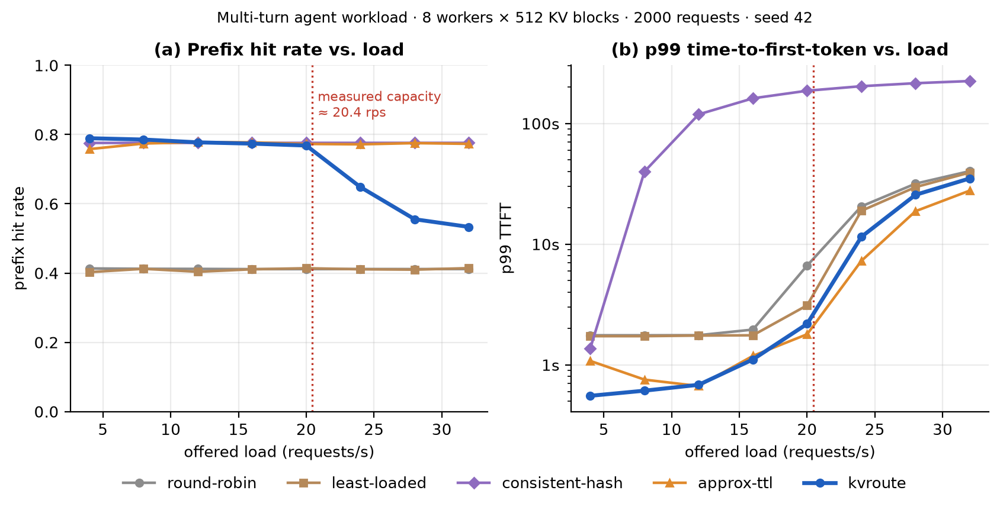
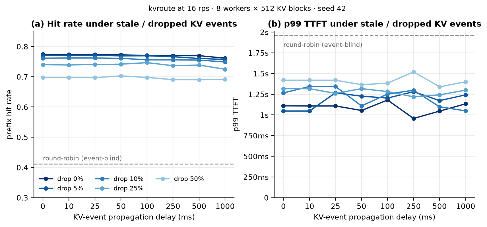
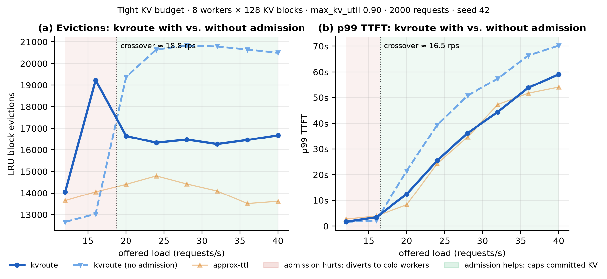
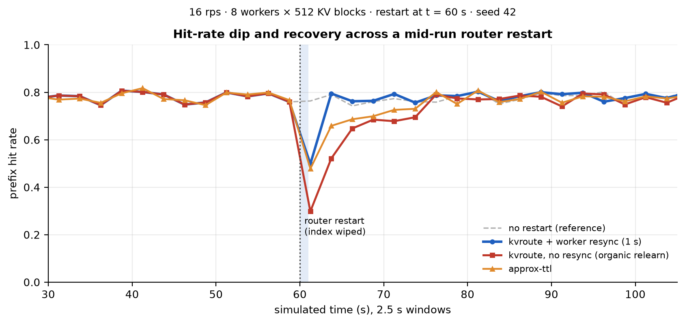

# kvroute

KV-cache-aware request routing for LLM inference fleets. kvroute sends each
request to the worker most likely to already hold its prompt prefix in KV
cache, and uses KV-budget admission control to stop that affinity from
overloading a worker. A discrete-event simulator and a production-style
HTTP/SSE proxy share one routing library, so what the simulator measures is
what the proxy runs.

```
                    ┌────────────────────────────────────────────┐
                    │ kvroute-core   pure · sync · deterministic │
                    │  chained 512-token block hashing           │
                    │  GlobalPrefixIndex (BlockHash → u128 set)  │
                    │  Router: α·match − β·queue − γ·kv_util     │
                    │  KV-budget admission (Admit | Defer)       │
                    └──────────┬──────────────────────┬──────────┘
                               │ identical routing    │
          ┌────────────────────┴───────┐   ┌──────────┴─────────────────────────┐
          │ kvroute-sim                │   │ kvroute-proxy                      │
          │ deterministic DES (µs heap)│   │ axum · tokio · reqwest             │
          │ vLLM-style pinned LRU KV   │   │ ArcSwap<Router> lock-free reads    │
          │ Mooncake + agent workloads │   │ single-writer KV-event actor       │
          │ staleness/drop/restart     │   │ InFlightGuard (SSE-abort safe)     │
          │ faults · CSV sweeps        │   │ OpenAI API · SSE · Prometheus      │
          └────────────────────────────┘   └────────────────────────────────────┘
```

See [DESIGN.md](DESIGN.md) for the mechanisms and the trade-offs behind them.

## Quickstart

```sh
make check   # cargo fmt --check && cargo clippy --workspace --all-targets -- -D warnings
make test    # cargo test --workspace
make build   # release binaries
make bench   # seeded sweeps -> benchmarks/results/*.csv -> benchmarks/plots/*.png (~15 s)
```

`make bench` uses a system `matplotlib` if one is installed; otherwise it
creates `.venv` from `scripts/requirements.txt`. Runs are seeded, so the CSVs
are byte-identical on every run.

**Simulator.** Compare every policy on the built-in multi-turn agent workload,
or on a Mooncake JSONL trace:

```sh
cargo run --release -p kvroute-sim -- --policy all --rps 16 --seed 42
cargo run --release -p kvroute-sim -- --trace mooncake.jsonl --rate-scale 2 --csv out.csv
cargo run --release -p kvroute-sim -- --policy kvroute --event-drop-prob 0.25 \
    --router-restart-ms 60000 --windowed-csv hit_over_time.csv
```

**Proxy.** Put kvroute in front of OpenAI-compatible backends; position in
`--workers` is the worker id:

```sh
cargo run --release -p kvroute-proxy -- --listen 0.0.0.0:8080 \
    --workers http://gpu0:8000,http://gpu1:8000 --max-kv-util 0.9

curl -N localhost:8080/v1/chat/completions -H 'content-type: application/json' \
    -d '{"model":"m","stream":true,"messages":[{"role":"user","content":"hi"}]}'
# Response headers: x-kvroute-worker, x-kvroute-matched-blocks
```

Workers report state to the proxy:
- `POST /internal/kv-events`: a JSON `CacheEvent` batch.
- `POST /internal/worker-metrics`: `kv_used_blocks`, `kv_capacity_blocks` and
  `healthy`. Report capacity at startup: a worker that hasn't reported it
  counts as full.

Operators get `POST /internal/reset-index`, `GET /healthz` and `GET /metrics`
(Prometheus). The `/internal/*` endpoints have no authentication, so don't
expose them to untrusted networks.

## Results

All figures come from `make bench`: a multi-turn agent workload (64 concurrent
sessions, 8 shared system prompts, 2000 requests, seed 42) on 8 simulated
workers. Each claim below is a number from `benchmarks/results/*.csv`.

### Load sweep



- **Below capacity, kvroute's p99 TTFT is 1.6–3.2× lower than the load
  balancers'.**

  | | round-robin | least-loaded | kvroute |
  |---|---|---|---|
  | p99 TTFT at 4 rps | 1757 ms | 1728 ms | **554 ms** |
  | p99 TTFT at 16 rps | 1959 ms | 1757 ms | **1108 ms** |
  | hit rate at 16 rps | 0.411 | 0.411 | **0.774** |
  | evictions at 16 rps | 19 517 | 19 535 | **5 014** (−74%) |
- **Consistent hashing on the prompt prefix has a high hit rate (0.776) but
  saturates hot workers.** Sessions sharing a system prompt all land on one
  worker. Throughput caps at 6.7 rps and p99 TTFT reaches 40 s at just 8 rps.
- **Above the measured capacity of about 20 rps, kvroute's hit rate drops to
  0.53 while approx-ttl holds 0.77.** See failure mode 3.

### Staleness and event loss



- **Routing degrades slowly.** At 16 rps, a 1 s event delay lowers the hit
  rate only from 0.774 to 0.761.
- **Event loss costs more than delay.** 50% loss gives 0.697, and 50% loss
  plus 1 s delay gives 0.692.
- **Every swept setting stays far above the event-blind round-robin level**
  (0.411), and p99 TTFT stays at 0.96–1.52 s against round-robin's 1.96 s.

### Admission-control ablation (128-block KV budget)



- **Admission control has a crossover, which the plot computes from the data.**
  Below about 16.5 rps (p99) and 18.8 rps (evictions) it hurts. Above that it
  wins:

  | | with admission | without |
  |---|---|---|
  | evictions at 28 rps | **16 477** | 20 827 |
  | p99 TTFT at 28 rps | **36.2 s** | 50.7 s |
  | hit rate at 28 rps | **0.564** | 0.456 |
  | p99 TTFT at 40 rps | **59.1 s** | 70.2 s |
- **Its cost at moderate load is real.** See failure mode 1.

### Router restart



- **The restart at t = 60 s wipes the prefix index.** Before it, the hit rate
  is steady at about 0.78.
- **With a 1 s worker resync**, the 60–62.5 s window dips to 0.50 and the next
  window is back to 0.79.
- **Without resync**, the dip reaches 0.30 and recovery takes about 15 s:
  0.52, 0.65, 0.68, 0.68, 0.69, then 0.79 at t = 75 s.

## Where kvroute loses (failure modes and trade-offs)

1. **Admission diverts traffic at moderate load.** When a session's warm
   worker crosses `max_kv_util`, admission sends the request to a cold worker.
   A short queue wait becomes a full prefill miss that also evicts other
   sessions' blocks on the cold worker. At 16 rps with 128-block workers,
   admission costs hit rate (0.495 vs 0.650), evictions (19 223 vs 13 036) and
   p99 TTFT (3.45 s vs 2.18 s, +58%). Raising `max_kv_util` is not a fix. In
   a 600-request sweep, a value of 2.0 matched no-admission at 14 rps, but
   values from 1.2 to 2.0 lost to no-admission at 20–40 rps, giving up the
   overload win. The likely fix is to defer, not divert, when the over-budget
   worker is the one holding the prefix.

2. **Event loss erodes routing gradually.** In the swept range the decline is
   gentle (see Results); the collapse comes at heavy loss:

   | | hit rate |
   |---|---|
   | fresh events | 0.774 |
   | 75% loss | 0.622 |
   | 90% loss | 0.518 |
   | 100% loss | **0.407** (round-robin: 0.411) |
   | 10 s event delay | 0.584 |

   Lost `BlockRemoved` events leave ghost entries that route sessions to
   workers that no longer hold their blocks. Lost `BlockStored` events hide
   real cache hits. Either way the router drifts toward event-blind behaviour.

3. **Under overload, the exact index lags dispatch, and approx-ttl wins.** The
   exact index learns a block only when the request starts and the worker
   reports it. Above capacity, requests wait seconds in worker queues
   (`kvroute` p50 TTFT is 4.1 s at 24 rps), so a session's next turn arrives
   before the previous turn has started and is routed away from it.

   | | kvroute | approx-ttl |
   |---|---|---|
   | hit rate at 32 rps (512 blocks) | 0.533 | **0.773** |
   | p99 TTFT at 24 rps (512 blocks) | 11.5 s | **7.3 s** |
   | hit rate at 28 rps (128 blocks) | 0.564 | **0.616** |

   approx-ttl records blocks optimistically at dispatch, so it keeps sessions
   together. An experiment that also recorded blocks at dispatch in kvroute
   reproduced approx-ttl's numbers exactly. That makes dispatch lag, not
   eviction tracking, the root cause. A short-lived index entry recorded at
   dispatch, which later events confirm or retract, is the planned fix. Part
   of admission's overload win (mode 1) also comes from this lag.

4. **A router restart without worker resync takes about 15 s to recover.** The
   index only hears about blocks when they are stored. Blocks that stay
   resident, such as hot system prompts, become invisible until they are
   evicted and recomputed. Hit rate fell to 0.30 and recovered only at
   t ≈ 75 s, against one 2.5 s window with resync. Production deployments
   should have workers republish their resident blocks when the router
   reconnects.

Other limits of the model:
- Simulated batch slots don't share compute, which flatters throughput under
  heavy load.
- The proxy can't see real cache hits, so
  `kvroute_prefix_matched_blocks_total` is the router's expectation.
- The proxy's admission decision is only as fresh as the last
  `/internal/worker-metrics` report.

## Repository layout

```
crates/kvroute-core/    hash.rs · index.rs · scorer.rs · admission.rs
crates/kvroute-sim/     workload.rs · worker.rs · policy.rs · engine.rs · tests/
crates/kvroute-proxy/   state.rs · proxy.rs · admin.rs · tests/proxy_e2e.rs
scripts/                run_benchmarks.sh · plot_benchmarks.py · requirements.txt
benchmarks/             results/ (CSV, regenerated) · plots/ (PNG, tracked)
```

## License

MIT
